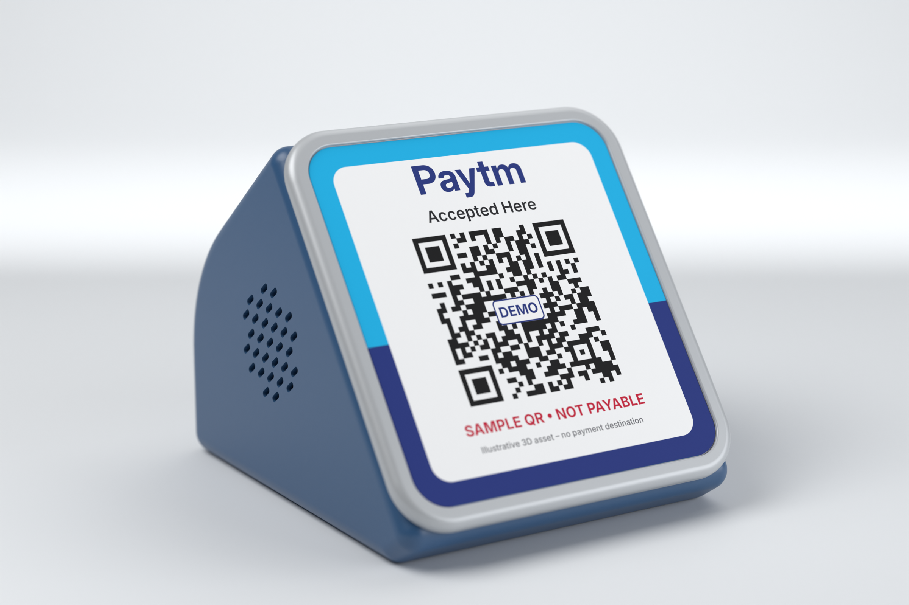

# Soundbox 5.0: photoreal, AR-ready 3D asset

An editable Blender model and web/AR GLBs of the Soundbox 5.0 industrial design. They are built procedurally from
proportions measured on the public PencilProto design renders, for the Paytm Reality Lab AR experience.



> **Independent illustrative asset.** This is not an official Paytm model and is not affiliated with or endorsed by Paytm.
> The front QR is an **unmistakably non-payable demo code**: it encodes the text `PAYTM REALITY LAB DEMO - NOT A PAYMENT CODE`
> and has no UPI destination. Dimensions are **provisional** until a physical unit is measured.

| Deliverable | File |
|---|---|
| Editable master | `paytm-soundbox-5.blend` |
| Web product viewer | `exports/paytm-soundbox-5-hero.glb` (23k tris, ~0.8 MB) |
| Mobile AR | `exports/paytm-soundbox-5-ar.glb` (9k tris, ~0.24 MB, WebP + quantised) |
| Renders | `renders/{front,left,right,rear,top,threequarter,hero}.png` |
| Technical report | [`REPORT.md`](REPORT.md) |
| Reference analysis | [`reference/REFERENCE_MANIFEST.md`](reference/REFERENCE_MANIFEST.md) |

## Using it in three.js

```ts
const gltf = await new GLTFLoader().loadAsync('/models/paytm-soundbox-5-ar.glb');
const anchor = gltf.scene.getObjectByName('Ground_Anchor')!;   // origin = ground contact, metres, +Y up, QR faces +Z
anchor.position.copy(hitTestPose.position);
const qr = gltf.scene.getObjectByName('QR_Panel')!;            // qr.userData.payable === false
const buttons = gltf.scene.getObjectByName('Top_Controls')!.children; // userData.function: volume_up | volume_down | repeat_last_announcement | power
```

Named components are `Ground_Anchor`, `Soundbox_Body`, `Front_Faceplate`, `QR_Panel`, `Speaker_Region`, `Top_Controls`
and `Status_Indicator`, plus `Status_LED_1..4` and `Status_Display`. Colourways (Cobalt, Fabric Blue, Icy White) ship as
`KHR_materials_variants`.

## Rebuild

Requirements:
* Blender 4.2 LTS
* Python 3 with Pillow and segno (`pip install pillow segno`); add `opencv-python-headless` for the QR check
* Node 20+

```bash
./build_all.sh
```

```bash
RENDER=1 ./build_all.sh
```

The first command rebuilds the textures, both LODs, the GLBs and the validation. The second does the same and also
re-renders everything.

The geometry is driven by `scripts/params.json`. To recalibrate to a measured unit, change `H` (the overall scale) or any
fitted proportion, then rebuild.

| Script | Role |
|---|---|
| `scripts/make_textures.py` | QR sticker (non-payable), LCD screen, button icon atlas |
| `scripts/build_soundbox.py` | Procedural geometry with analytic normals, PBR materials, named hierarchy (`--lod hero\|ar`) |
| `scripts/render_views.py` | Cycles studio renders and orthographic silhouette masks |
| `scripts/compare_silhouettes.py` | IoU against the reference silhouettes (reference images are not stored here) |
| `scripts/export_glb.py`, `scripts/postprocess_glb.mjs` | glTF export, material variants, WebP, quantisation |
| `scripts/validate_glb.mjs` | Khronos glTF Validator plus asset statistics |
